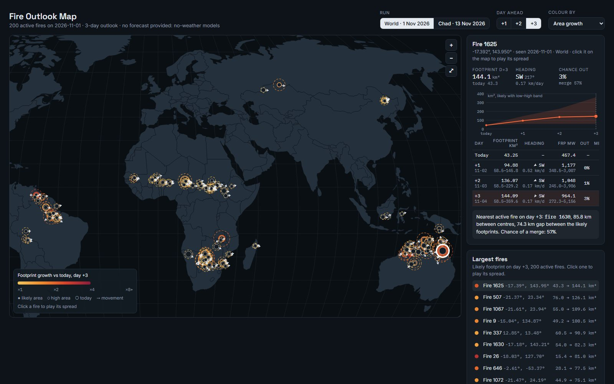

# Nasa: wildfire tracking and 3-day fire prediction

**Turns raw NASA FIRMS satellite fire detections into tracked fires, a knowledge graph and a 3-day forecast of how each fire grows, moves, burns and merges, with an interactive globe to explore it.**


```bash
python run_pipeline.py --date 2026-11-01 --days 1 --area world --no-weather
python prediction_engine.py --run data/runs/2026-11-01_1d_world --limit 200 --weather forecast.json
```

The first command downloads one day of worldwide MODIS and VIIRS detections from NASA FIRMS and runs the full tracking pipeline on it. The second predicts, for the 200 largest active fires, their footprint, spread direction and rate, fire power, chance of going out or merging with a neighbour, and a 1 km burn-chance map for each of the next 3 days. Each number comes as a low / likely / high range.

## What it does

| Part | What you get |
|---|---|
| Harmonisation | MODIS, VIIRS (Suomi NPP, NOAA-20, NOAA-21) and Landsat detections made directly comparable, with the FIRMS `type` field inferred where a file lacks it |
| Tracking pipeline | Detections linked across satellites and passes, false and duplicate detections removed, then each fire's position, movement, radiative power (FRP), starting points and pass-by-pass expansion: ignitions, bursts, merges, splits, extinctions |
| Weather | Hourly weather for every fire from Open-Meteo (ERA5 observations and archived ECMWF forecasts) |
| Knowledge graph | Every result of every stage as Neo4j bulk-import CSV files |
| Prediction engine | Two GPU-trained models, XGBoost and a sequence network, blended into a 3-day forecast per fire, plus a calibrated burn-chance map |
| Merge dataset | Every observed merge, with the individual fires before it and the merged fire after it, their geometry and the weather |
| Frontend | A React app with a 3D globe: pick a zone, load the detections, see the forecast and fire weather |

## Screenshots

| | |
|---|---|
|  |  |
| **Frontend: the globe.** Satellite imagery from Esri, borders from Natural Earth | **Frontend: a forecast** for a zone in southern Chad: expected burning cells for days +1 to +3, chance-of-fire chart, weather layers and a timeline of observed and forecast days |
|  |  |
| **Outlook map:** the 200 largest fires on 1 Nov 2026, coloured by predicted growth. The side panel shows one fire's 3-day ranges | **Fire view:** satellite pixels and the burned scar, the predicted likely and high footprints, spread arrows and merge partners for day +2 |


*Fire 1501 in southern Chad: four observed days of satellite fire pixels (bright on the day they burned, dark afterwards), then the 3 predicted days with likely and high footprints, spread direction and the chances of merging or going out. Made with `prediction_animation.py`.*

## Contents

- [Requirements and installation](#requirements-and-installation)
- [Configuration](#configuration)
- [Usage](#usage)
- [Frontend](#frontend)
- [Pipeline](#pipeline)
- [Prediction models](#prediction-models)
- [Metrics](#metrics)
- [Data layout](#data-layout)
- [Testing](#testing)
- [Limitations](#limitations)
- [Data sources and APIs](#data-sources-and-apis)
- [Credits](#credits)

## Requirements and installation

| Need | Version used | For |
|---|---|---|
| Python | 3.14.7 | Everything in Python |
| A NASA FIRMS map key | [request one](https://firms.modaps.eosdis.nasa.gov/api/map_key/) | Downloading detections |
| [Git LFS](https://git-lfs.com/) | 3.8 | The trained models in `models/v2/` (285 MB) |
| NVIDIA GPU with CUDA | RTX 5060, CUDA 12.8 | Training only; prediction runs on the CPU too |
| Node.js and npm | – | Only to change the frontend; its built version is in the repository |

```bash
git lfs install
git clone https://github.com/Stefania1305/Nasa.git
cd Nasa
pip install pandas numpy requests scipy scikit-learn xgboost matplotlib pillow
```

Tested with pandas 3.0.6, numpy 2.5.4, xgboost 3.4.1 (CUDA build), scikit-learn 1.9.1, scipy 1.18.1, requests 2.34.2, matplotlib 3.11.2 and Pillow 12.3.0. Training the sequence network also needs PyTorch with CUDA: `pip install torch --index-url https://download.pytorch.org/whl/cu128`. Running predictions does not.

If you cloned without Git LFS, fetch the models afterwards with `git lfs pull`.

## Configuration

Settings are read from a `.env` file in the project folder. It is git-ignored; never commit it.

```ini
FIRMS_MAP_KEY=your_firms_key
```

| Variable | Required | Default | Used for |
|---|---|---|---|
| `FIRMS_MAP_KEY` | yes | none | All FIRMS downloads |
| `FIRMS_MAP_KEYS` | no | `FIRMS_MAP_KEY` | Comma-separated keys for the 10-year archive scan; when one reaches its quota (5,000 transactions per 10 minutes), the next is used |
| `PORT` | no | `8000` | Port of the local server |
| `EWDS_API_KEY`, `EWDS_API_URL` | no | none | Copernicus CEMS fire danger indices; off by default |

Open-Meteo needs no key. Its free limits are 600 calls a minute, 5,000 an hour and about 10,000 a day.

## Usage

### Run the pipeline for a date and area

```bash
python run_pipeline.py --date 2026-11-01 --days 1 --area world --no-weather
```

| Option | Default | Meaning |
|---|---|---|
| `--date` | required | First day, `YYYY-MM-DD` |
| `--days` | `1` | Number of days |
| `--area` | `world` | `world` or a box `west,south,east,north`, for example `--area=-48,-12,-42,-6` |
| `--no-weather` | off | Skip the weather join and knowledge-graph feed 2 (a world day needs about 32,000 Open-Meteo calls) |
| `--start-at` | none | Skip earlier stages and reuse their output, for example `--start-at interpreter` |

Output goes to `data/runs/<date>_<days>d_<area>/`, with stage timings in `timings.json`. On a one-day world run, the stages from the interpreter to KG feed 1 took about 7 minutes.

### Predict

```bash
python prediction_engine.py --run data/runs/fires_batch_039 --weather forecast.json
```

```python
from prediction_engine import predict
result = predict(run_dir, weather=forecast_rows)      # forecast_rows: hourly forecast, list of dicts or DataFrame
```

| Option | Default | Meaning |
|---|---|---|
| `--run` | required | A pipeline run folder |
| `--weather` | none | Hourly weather forecast for the fires' area (`.json` or `.csv`). Without it, the no-weather models are used |
| `--weather-label` | none | Where the forecast came from; shown in `summary.json` and on the map |
| `--limit` | `0` (all) | Only the N largest active fires |

The engine does not download weather: the forecast comes from the caller (the frontend), as hourly rows in the units the models were trained on.

| Field | Unit | Required |
|---|---|---|
| `latitude`, `longitude` | degrees | yes |
| `time` | UTC hour, ISO 8601, e.g. `2026-11-14T13:00` | yes |
| `temperature_2m` | °C | recommended |
| `relative_humidity_2m` | % | recommended |
| `wind_speed_10m`, `wind_gusts_10m` | km/h | recommended |
| `wind_direction_10m` | degrees the wind comes from | recommended |
| `precipitation` | mm per hour | recommended |
| `vapour_pressure_deficit` | kPa | recommended |
| `soil_moisture_0_to_7cm`, `_7_to_28cm`, `_28_to_100cm` | m³/m³ | optional |
| `elevation` | m | optional |

```json
{"hourly": [
  {"latitude": 10.25, "longitude": 19.25, "time": "2026-11-14T13:00", "temperature_2m": 33.1,
   "relative_humidity_2m": 18, "wind_speed_10m": 14.2, "wind_direction_10m": 60, "wind_gusts_10m": 27.0,
   "precipitation": 0, "vapour_pressure_deficit": 4.1}
]}
```

The forecast should cover the run's last day through 3 days ahead; a few days before that let the engine count the hours since the last rain. Each fire uses the forecast point in its 0.25° cell, or the nearest within 0.5°. Missing variables or hours are allowed.

| Output in `<run>/prediction/` | Content |
|---|---|
| `predictions.csv`, `predictions.json` | One row per fire and day ahead, with low / likely / high values |
| `spread.csv` | Burn chance per 1 km cell around each fire and day ahead (cells of at least 2%) |
| `merge_outlook.csv` | Each fire's nearest neighbour, the gap between their predicted footprints and the merge chance |
| `summary.json` | Run, weather used and its coverage, models, timing |

### Build the 10-year archive and train the models

```bash
python archive_scan.py --start 2016-11-14 --end 2026-11-13
python fire_runs.py --major 1000 --medium 1000
python weather_fires.py
python prediction_data.py
python forecast_errors.py
python prediction_train.py --device cuda --full --noise
python prediction_seq.py --full --epochs 16 --out models_seq_full
python prediction_spread.py fit
```

| Step | What it does |
|---|---|
| `archive_scan.py` | Downloads 10 years of MODIS and VIIRS worldwide, builds a fire frequency map and ranks the biggest fires |
| `fire_runs.py` | Picks 1,000 major and 1,000 medium fires across regions and runs the full pipeline on them in 40 batches |
| `weather_fires.py` | Adds weather to every batch and feeds it into the knowledge graph, within the Open-Meteo quota |
| `prediction_data.py` | Builds the training table: one row per fire per day, 333,452 fire-days from 188,559 fires, with targets for days +1 to +3 |
| `forecast_errors.py` | Measures how wrong real weather forecasts were at about 200 cells: a pool of 4,590 error vectors used in training |
| `prediction_train.py` | Trains the XGBoost models with and without weather (42 models, about 25 minutes on the GPU). `--noise` uses forecast-like weather, `--full` all years |
| `prediction_seq.py` | Trains the sequence network (about 1 minute on the GPU) and saves it for numpy too |
| `prediction_spread.py fit` | Calibrates the burn-chance map on 2024 and checks it on 2025–2026 |

### Animation and merge datasets

```bash
python prediction_animation.py --run data/runs/fires_batch_039 --fire 1501
python merges_dataset.py
```

`prediction_animation.py` writes `<run>/prediction/spread_<fire>.gif`. `merges_dataset.py` writes `data/prediction/merges.csv.gz` (one row per merge: 166,044 merges, 51,051 of them lasting merges of separate fires) and `merge_members.csv.gz` (one row per fire involved: 405,039 individual fires before a merge and 275,049 merged fires after it, sharing an `event_id`).

## Frontend

**Fire Pattern Predictor** is a React app by Diaco12, on the [`frontend`](https://github.com/Stefania1305/Nasa/tree/frontend) branch. It is not yet connected to the prediction models described below: its forecast uses a separate grid model ([see below](#frontend-grid-model)).

| Feature | Description |
|---|---|
| Opening screen | Live status of each satellite's latest data (MODIS, VIIRS on Suomi NPP, NOAA-20 and NOAA-21, Landsat OLI) and a spinning globe |
| 3D globe | MapLibre GL globe with Esri satellite imagery, Natural Earth borders, zoom and a live UTC clock |
| Zones | Draw a box, click a country (or one of its territories), drop a pin with an area, or type coordinates |
| Analyse zone | Load either all sensors harmonised into one dataset, or one sensor's raw detections, for a chosen date range |
| Forecast | Expected burning cells for days +1 to +3, cells by chance of fire, spread direction, trend, most likely new fires, and a timeline of observed and forecast days |
| Fire weather | Temperature, humidity and wind layers over the zone from Open-Meteo |


| Part | Technology |
|---|---|
| UI | [React](https://react.dev/) 18, TypeScript, [Vite](https://vite.dev/) 6 |
| Map | [MapLibre GL](https://maplibre.org/) 5.6 (globe projection) |
| State | [Zustand](https://github.com/pmndrs/zustand) 5 |
| Fonts | IBM Plex Sans and IBM Plex Mono |
| Backend | `server.py` serves the built app at `http://localhost:8000/app` |

```bash
git switch frontend
python server.py          # then open http://localhost:8000/app

cd frontend               # only to change the app
npm install
npm run dev               # http://localhost:5173/app/, API calls go to the backend on :8000
npm run build
```

| Endpoint (`frontend` branch) | Returns |
|---|---|
| `/api/sensors` | Available FIRMS sensors and their date ranges |
| `/api/harmonise` | All sensors harmonised for a date range and area |
| `/api/fires` | One sensor's detections |
| `/api/compare` | MODIS and VIIRS made comparable |
| `/api/predict` | The grid forecast for a zone (`date`, `days`, `area`, optional `country`) |
| `/api/weather` | Fire weather for a zone from Open-Meteo |

## Pipeline

```
FIRMS download
  -> correlation          link detections across satellites and passes
  -> interpreter          clean and plan the work
  -> localisation  ┐      position and movement per pass
  -> fire power    ┘      radiative power per pass (both run at the same time)
  -> epicenter            where each fire started
  -> fire expansion       clusters followed pass by pass
  -> KG feed 1 (fire)     kg_builder.py
  -> weather join         weather_worker.py
  -> KG feed 2 (weather)  kg_weather_feed.py
```

Each stage reads the previous stage's files in the run folder. The knowledge graph (`<run>/kg/`) holds every worker's results as `nodes_*.csv.gz` and `rels_*.csv.gz` in [Neo4j bulk-import format](https://neo4j.com/docs/operations-manual/current/import/). Node types include `Fire`, `SourceFire`, `Detection`, `Cluster`, `FireState`, `Epicenter`, `ExpansionEvent`, `Pass`, `Satellite`, `WeatherCell` and `WeatherHour`.

## Prediction models

| Model | What it is | Where | Status |
|---|---|---|---|
| Fast model | XGBoost, 87 features, trained on observed weather; one quantile model per output and day ahead (42 models) | `data/prediction/models_split`, `models_fast_all` | Superseded, kept for comparison |
| Full model: XGBoost v2 | XGBoost, 118 features (history, separate parts, neighbours), trained on forecast-like weather | `models/v2/weather`, `models/v2/no_weather` | In production |
| Full model: sequence network | A GRU over the fire's previous 4 fire-days plus dense layers, all outputs and days at once, trained with weather dropout and forecast noise. Trained with [PyTorch](https://pytorch.org/), run with numpy | `models/v2/seq` | In production |
| **Production blend** | XGBoost v2 and the network averaged for growth, fire power, movement and merging; the chance a fire is out from XGBoost alone | `prediction_engine.py` | **In production** |
| Spread map | Logistic model turning distance and position around today's moved and spread-out pixels into a burn chance per 1 km cell | `models/v2/spread.json` | In production |
| Frontend grid model | Ridge-regularised logistic regression on 5.6 km grid cells, refitted on each zone's loaded days | `prediction.py` on the `frontend` branch | In the app today |

For every fire seen on the run's last day, the engine predicts days +1, +2 and +3:

| Output | Unit | Form |
|---|---|---|
| New burned area and total footprint | km² | low / likely / high (10th / 50th / 90th percentile) |
| Movement of the fire centre, spread direction and rate | km, degrees, km/day | low / likely / high |
| Mean and peak fire power of a VIIRS pass | MW | low / likely / high |
| Chance the fire is out | 0 to 1 | probability |
| Chance it merges with a separate neighbouring fire | 0 to 1 | probability |
| Burn chance of each 1 km cell around the fire | 0 to 1 | spread map |

| Feature group | Features (118 in the full model) |
|---|---|
| Fire now | Size, footprint, growth, fire power, pixels, passes, clusters, front distance, age, merges so far |
| History | The previous 4 fire-days: growth, power, separate parts, days back; 3-day trends |
| Separate parts | How many not-yet-joined fires the fire consists of that day, and the gap between them |
| Neighbours | Distance and gap to the nearest other fire, its size, growth and power, fires within 10 and 25 km |
| Place | Latitude, region, season, elevation, local 10-year fire frequency |
| Weather, days d to d+3 | Temperature, humidity, vapour pressure deficit, wind, gusts and direction, rain, hours since rain, soil moisture at 3 depths, wind towards the nearest fire |

The full models train on **forecast-like weather**: each training row's weather for days +1 to +3 gets a real forecast error added (same day ahead and region), so they trust a forecast only as much as forecasts deserve.

## Metrics

All models below were trained on 2016–2023 (2024 used only to decide when to stop and to pick thresholds) and tested on **2025–2026, which none of them saw: 49,378 fire-days from 28,657 fires**. Each cell shows **day +1 / +2 / +3**, with weather unless stated. Persistence means "the fire keeps doing what it did today": still burning, never merges, same growth, power and movement. The production models are the same setups trained on all years, so these are the best estimate for them. Produced by `prediction_metrics.py` and `test_prediction_accuracy.py`; full results are in `data/prediction/accuracy/`.

### Headline accuracy

The overall figure is the mean of five accuracies: growth class (none / small / large), fire power within a factor of 2, direction within 45°, extinction, and merge balanced accuracy, with the merge threshold chosen for the best balanced accuracy on 2024.

| Model | Overall accuracy %, with weather | Overall accuracy %, no weather |
|---|---|---|
| Fast model | 65.2 / 65.0 / 64.9 | 64.3 / 63.5 / 63.3 |
| Full model: XGBoost v2 | 65.4 / 65.6 / 65.4 | 64.7 / 64.1 / 64.1 |
| Full model: sequence network | 64.9 / 65.4 / 65.6 | 63.9 / 64.0 / 64.2 |
| Blend, averaging both for every output | 65.8 / 65.8 / 65.8 | 64.9 / 64.2 / 64.5 |
| **Production blend** (extinction from XGBoost) | **about 65.9 / 65.9 / 65.8** | – |
| Persistence baseline | 34.1 / 30.7 / 28.9 | – |

The production row is worked out from the per-output results of the two rows above it. In the detailed tables below the merge threshold is instead chosen for the **best F1**, which raises merge precision and lowers merge balanced accuracy; with that threshold the production blend's overall figure is 62.5 / 63.3 / 63.9%.

### Extinction (is the fire out by that day?)

Threshold 0.5. Calibration error: mean gap between the predicted chance and how often fires were really out, over 10 bins.

| Model | Accuracy % | Precision % | Recall % | F1 % | ROC AUC | PR AUC | Brier | Calibration error, pts |
|---|---|---|---|---|---|---|---|---|
| Fast model (XGBoost, first version) | 83.0 / 83.7 / 84.4 | 83.8 / 86.4 / 88.0 | 87.7 / 89.9 / 91.3 | 85.7 / 88.1 / 89.6 | 0.914 / 0.909 / 0.903 | 0.932 / 0.952 / 0.963 | 0.1164 / 0.1125 / 0.1073 | 0.90 / 1.12 / 1.34 |
| Full model: XGBoost v2 | 83.4 / 84.0 / 84.7 | 83.4 / 86.3 / 87.7 | 89.0 / 90.7 / 92.3 | 86.1 / 88.5 / 89.9 | 0.917 / 0.913 / 0.907 | 0.936 / 0.954 / 0.964 | 0.1142 / 0.1100 / 0.1045 | 0.72 / 0.74 / 0.83 |
| Full model: sequence network | 79.9 / 82.7 / 84.8 | 78.5 / 83.5 / 86.5 | 89.8 / 92.7 / 94.0 | 83.8 / 87.9 / 90.1 | 0.867 / 0.881 / 0.885 | 0.885 / 0.933 / 0.952 | 0.1407 / 0.1230 / 0.1104 | 0.49 / 0.54 / 1.22 |
| **Production: blend** | 83.4 / 84.0 / 84.7 | 83.4 / 86.3 / 87.7 | 89.0 / 90.7 / 92.3 | 86.1 / 88.5 / 89.9 | 0.917 / 0.913 / 0.907 | 0.936 / 0.954 / 0.964 | 0.1142 / 0.1100 / 0.1045 | 0.72 / 0.74 / 0.83 |
| Persistence baseline | 42.1 / 32.6 / 26.1 | 0.0 / 0.0 / 0.0 | 0.0 / 0.0 / 0.0 | 0.0 / 0.0 / 0.0 | – / – / – | – / – / – | – / – / – | – / – / – |

### Merging with a separate fire

Threshold chosen for the best F1 on 2024. Merges are rare (4–8% of fire-days), so plain accuracy is not shown; PR AUC is the more telling ranking score.

| Model | Balanced acc. % | Precision % | Recall % | F1 % | ROC AUC | PR AUC | Brier |
|---|---|---|---|---|---|---|---|
| Fast model (XGBoost, first version) | 67.9 / 74.4 / 75.9 | 43.8 / 46.3 / 50.9 | 37.8 / 53.1 / 56.4 | 40.6 / 49.4 / 53.5 | 0.935 / 0.928 / 0.925 | 0.418 / 0.496 / 0.552 | 0.0327 / 0.0457 / 0.0522 |
| Full model: XGBoost v2 | 72.9 / 76.8 / 78.7 | 47.0 / 51.5 / 54.4 | 48.1 / 57.3 / 61.9 | 47.6 / 54.2 / 57.9 | 0.946 / 0.939 / 0.935 | 0.502 / 0.591 / 0.641 | 0.0271 / 0.0382 / 0.0445 |
| Full model: sequence network | 72.9 / 77.0 / 78.0 | 48.4 / 52.5 / 56.0 | 47.9 / 57.6 / 60.1 | 48.2 / 54.9 / 58.0 | 0.945 / 0.938 / 0.934 | 0.515 / 0.596 / 0.643 | 0.0265 / 0.0377 / 0.0442 |
| **Production: blend** | 71.1 / 74.6 / 77.6 | 53.1 / 57.3 / 58.7 | 43.9 / 51.9 / 58.9 | 48.1 / 54.4 / 58.8 | 0.947 / 0.941 / 0.937 | 0.519 / 0.601 / 0.649 | 0.0265 / 0.0376 / 0.0439 |
| Persistence baseline | 50.0 / 50.0 / 50.0 | 0.0 / 0.0 / 0.0 | 0.0 / 0.0 / 0.0 | 0.0 / 0.0 / 0.0 | – / – / – | – / – / – | – / – / – |

### Growth of the burned area

Class: none (< 0.1 km²), small (0.1–2 km²) or large (≥ 2 km²). Coverage: share of real values inside the low–high range (the 10th–90th percentile, aim about 80%).

| Model | MAE km² | Class accuracy % | Class macro F1 % | Low–high coverage % | Pinball loss (log) |
|---|---|---|---|---|---|
| Fast model (XGBoost, first version) | 1.95 / 3.55 / 4.87 | 79.1 / 81.2 / 83.0 | 61.6 / 60.6 / 57.6 | 87.8 / 88.0 / 88.7 | 0.0670 / 0.0767 / 0.0800 |
| Full model: XGBoost v2 | 1.96 / 3.52 / 4.82 | 79.3 / 81.5 / 83.5 | 61.8 / 60.7 / 58.4 | 87.6 / 87.1 / 87.7 | 0.0662 / 0.0750 / 0.0775 |
| Full model: sequence network | 1.96 / 3.49 / 4.77 | 79.7 / 81.9 / 83.8 | 65.0 / 63.5 / 61.9 | 87.5 / 88.6 / 87.6 | 0.0652 / 0.0722 / 0.0736 |
| **Production: blend** | 1.91 / 3.40 / 4.63 | 79.7 / 81.7 / 83.6 | 64.4 / 62.9 / 61.3 | 87.5 / 88.1 / 88.5 | 0.0641 / 0.0716 / 0.0734 |
| Persistence baseline | 2.86 / 5.99 / 9.51 | 26.2 / 22.9 / 20.3 | 33.8 / 27.7 / 22.7 | – / – / – | – / – / – |

### Fire power (FRP)

| Model | MAE MW | Within ×2 % | Low–high coverage % | Peak FRP MAE MW |
|---|---|---|---|---|
| Fast model (XGBoost, first version) | 372 / 465 / 537 | 37.6 / 34.6 / 34.2 | 73.1 / 72.3 / 72.8 | 679 / 876 / 1019 |
| Full model: XGBoost v2 | 370 / 464 / 535 | 38.0 / 35.5 / 34.8 | 72.4 / 73.3 / 71.3 | 682 / 871 / 1000 |
| Full model: sequence network | 374 / 468 / 533 | 38.2 / 35.9 / 35.2 | 77.4 / 77.8 / 77.7 | 687 / 873 / 1020 |
| **Production: blend** | 365 / 459 / 526 | 38.9 / 36.2 / 35.1 | 75.8 / 76.5 / 75.2 | 670 / 857 / 993 |
| Persistence baseline | 520 / 715 / 805 | 32.1 / 28.9 / 28.5 | – / – / – | 956 / 1342 / 1549 |

### Spread direction and centre movement

Fires that moved at least 1 km.

| Model | Within 45° % | Within 90° % | Median angle error ° | Median centre error km |
|---|---|---|---|---|
| Fast model (XGBoost, first version) | 39.7 / 39.4 / 37.2 | 63.2 / 63.4 / 61.8 | 62.6 / 62.9 / 66.7 | 2.93 / 3.48 / 3.96 |
| Full model: XGBoost v2 | 39.2 / 39.7 / 37.2 | 62.9 / 63.1 / 61.9 | 64.1 / 62.7 / 66.3 | 2.92 / 3.50 / 3.96 |
| Full model: sequence network | 39.1 / 39.0 / 37.7 | 63.0 / 63.1 / 62.2 | 63.3 / 64.1 / 67.0 | 2.92 / 3.49 / 3.95 |
| **Production: blend** | 39.6 / 40.0 / 38.4 | 63.5 / 63.2 / 62.4 | 63.0 / 62.5 / 65.7 | 2.90 / 3.47 / 3.90 |
| Persistence baseline | 20.1 / 19.1 / 19.4 | 36.3 / 36.2 / 36.9 | 120.7 / 120.7 / 118.4 | 6.03 / 9.90 / 13.98 |

### Without weather

| Model | Overall % (F1 threshold) | Extinction ROC AUC | Merge ROC AUC | Growth MAE km² | FRP within ×2 % |
|---|---|---|---|---|---|
| Fast model (XGBoost, first version) | 61.3 / 61.1 / 61.7 | 0.890 / 0.867 / 0.851 | 0.929 / 0.923 / 0.918 | 2.13 / 4.12 / 6.07 | 37.4 / 33.3 / 33.5 |
| Full model: XGBoost v2 | 61.4 / 61.9 / 62.2 | 0.896 / 0.875 / 0.861 | 0.942 / 0.934 / 0.929 | 2.11 / 4.07 / 5.89 | 37.3 / 34.7 / 34.2 |
| Full model: sequence network | 60.5 / 61.8 / 62.2 | 0.834 / 0.831 / 0.824 | 0.942 / 0.933 / 0.926 | 2.11 / 4.00 / 5.75 | 38.0 / 35.4 / 34.8 |
| **Production: blend** | 61.9 / 62.4 / 62.6 | 0.896 / 0.875 / 0.861 | 0.944 / 0.936 / 0.930 | 2.05 / 3.88 / 5.59 | 37.9 / 35.0 / 34.9 |

### With real weather forecasts

Training uses weather that actually happened, with forecast errors added. To check real use, 600 fire-days from 2024–2026 were predicted again with the forecasts that were issued at the time (Open-Meteo previous-runs API):

| Overall accuracy %, day +1 / +2 / +3 | Fast model | Full model: XGBoost v2 |
|---|---|---|
| Observed weather | 66.1 / 65.3 / 65.9 | 67.0 / 65.7 / 66.4 |
| **Issued forecasts (real use)** | 64.1 / 62.1 / 64.5 | **65.0 / 63.8 / 64.8** |
| No-weather models | 64.9 / 62.8 / 64.7 | 65.2 / 63.1 / 64.4 |
| Persistence | 35.8 / 33.3 / 31.9 | 35.8 / 33.3 / 31.9 |

Training on forecast-like weather raised real-use accuracy by 0.3–1.7 points. The fast model's figures were measured before a fix to the merge targets. The blend has not been tested with real forecasts yet.

### Robustness

Retrained without one year or one world region and tested on what was left out (quicker check models: learning rate 0.1, days +1 and +3).

| Left out of training | Fast model, overall % day +1 / +3 | Full model XGBoost v2, overall % day +1 / +3 |
|---|---|---|
| Year 2022 | 65.3 / 65.5 | – |
| Year 2023 | 65.3 / 64.2 | – |
| Year 2024 | 65.4 / 64.4 | 65.5 / 64.7 |
| Americas | 62.8 / 63.0 | 62.5 / 62.5 |
| Africa | 64.1 / 63.9 | 64.9 / 64.5 |
| Asia and Australia | 63.5 / 63.7 | – |

### Spread map (burn chance per 1 km cell)

Calibrated on 2024, checked on 2025–2026. A cell counts as burned if any satellite detected fire in it that day.

| Day | ROC AUC | Brier | Brier of the base rate | Cells that burned % | Cells checked |
|---|---|---|---|---|---|
| Day +1 | 0.728 | 0.0477 | 0.0502 | 5.3 | 451,051 |
| Day +2 | 0.732 | 0.0338 | 0.0348 | 3.61 | 473,015 |
| Day +3 | 0.753 | 0.0250 | 0.0257 | 2.64 | 491,278 |

Cells marked 30% burned about 30% of the time.

### Behaviour checks

| Check | Fast | XGBoost v2 | Network | Blend |
|---|---|---|---|---|
| More wind gives more growth | ✓ | ✓ | ✓ | ✓ |
| Drier air gives more growth and more fire power | ✓ | ✓ | ✓ | ✓ |
| Rain raises the chance of extinction and cuts growth | ✓ | ✓ | ✓ | ✓ |
| Turning the wind turns the predicted spread | ✓ | ✓ | ✗ | ✓ |
| Raw growth never negative (the engine sets negatives to zero) | ✗ | ✗ | ✓ | ✗ |
| Ranges ordered, chances in 0..1, deterministic, works without weather | ✓ | ✓ | ✓ | ✓ |

### Frontend grid model

The app's grid model scores itself on each request: it is refitted without the last loaded day and asked to predict it, then compared with persistence. For the southern Chad zone in the screenshots (18.5–19.6° E, 9.8–11.0° N, 9–13 Nov 2026, 5.6 km cells, top 123 cells):

| | AUC | Precision % | Recall % | F1 % |
|---|---|---|---|---|
| Frontend grid model | 0.739 | 28.5 | 33.0 | 30.6 |
| Persistence (cells burning yesterday) | – | 37.6 | 44.3 | 40.7 |

That is one zone and one day, so it says little in general, but here persistence did better than the grid model.

## Data layout

```
models/v2/                   production models shipped with the repository (Git LFS)
  weather/ no_weather/       21 compressed XGBoost models each
  seq/                       sequence network as numpy arrays
  spread.json, model_card.json
docs/images/                 README images
data/                        git-ignored: rebuild with the commands in Usage
  archive/                   10-year scan: raw FIRMS files, frequency map, selected fires
  runs/<run>/                one folder per pipeline run: stage outputs, kg/, prediction/, timings.json
  prediction/                training table, models, forecast errors, merge datasets, accuracy results
  weather_cache/             cached Open-Meteo responses
```

## Testing

```bash
python test_correlation.py
python test_interpreter.py
python test_localisation.py
python test_fire_power.py
python test_epicenter.py
python test_expansion.py
python test_weather.py
python test_prediction.py
```

These run offline, with no key. The accuracy tests need the training table and models:

| Command | Checks |
|---|---|
| `python prediction_metrics.py` | Every metric above for every model |
| `python test_prediction_accuracy.py heldout` | Accuracy on 2025–2026, by region, fire size, season and weather coverage, plus calibration |
| `python test_prediction_accuracy.py behaviour` | Response to wind, humidity and rain, plus output rules |
| `python test_prediction_accuracy.py cv` | Retrains without one year or region (GPU) |
| `python test_prediction_accuracy.py forecast` | Accuracy with archived real forecasts (uses Open-Meteo) |

`PRED_MODELS=<folder>` tests another model folder, `PRED_BLEND=models_v2,models_seq` the blend, and `PRED_SOIL_FROM_D=1` gives days +1 to +3 day d's soil moisture, as the full models expect.

## Limitations

- **Shape:** the engine predicts each fire's area, centre shift, direction and power, not its outline.
- **Direction and fire power** are the weakest outputs (about 39% within 45° and 35–39% within ×2), though about twice as good as persistence.
- **Merge alarms:** about half of them are right at the F1 threshold, fewer at the balanced threshold.
- **Weather coverage:** only about half of the training rows have weather; small fires outside the fetched cells have none.
- **Simulated forecast errors:** drawn from real errors at about 200 cells, which approximates training on archived forecasts.
- **Soil moisture:** days +1 to +3 use day d's value, because the forecast archive has none.
- **First day:** a fire seen for the first time has no history, so its predictions are less reliable.
- **Spread map:** satellites see only actively burning pixels at overpass time, so 3–5% of nearby cells register as burning on a day, which limits how sharp the map can be.
- **Frontend:** not yet connected to the production models.

## Data sources and APIs

| Source | Used for | Links |
|---|---|---|
| **NASA FIRMS** (Fire Information for Resource Management System) | All fire detections: MODIS, VIIRS and Landsat, near-real-time and standard products | [FIRMS](https://firms.modaps.eosdis.nasa.gov/) · [API](https://firms.modaps.eosdis.nasa.gov/api/) · [Area API](https://firms.modaps.eosdis.nasa.gov/api/area/) · [Data availability](https://firms.modaps.eosdis.nasa.gov/api/data_availability/) · [Map key](https://firms.modaps.eosdis.nasa.gov/api/map_key/) · [About FIRMS](https://www.earthdata.nasa.gov/data/tools/firms) · [FAQ](https://www.earthdata.nasa.gov/data/tools/firms/faq) |
| **MODIS** on NASA's Terra and Aqua | 1 km active fire detections | [NASA Earthdata: MODIS](https://www.earthdata.nasa.gov/data/instruments/modis) |
| **VIIRS** on Suomi NPP, NOAA-20 and NOAA-21 | 375 m active fire detections | [NASA Earthdata: VIIRS](https://www.earthdata.nasa.gov/data/instruments/viirs) · [NOAA JPSS](https://www.nesdis.noaa.gov/our-satellites/currently-flying/joint-polar-satellite-system) |
| **Landsat** 8 and 9 (OLI) | 30 m active fire detections (frontend) | [NASA Landsat](https://landsat.gsfc.nasa.gov/) |
| **Open-Meteo** | Observed hourly weather (ERA5), archived forecasts for training and testing, frontend fire weather | [Open-Meteo](https://open-meteo.com/) · [Forecast API](https://open-meteo.com/en/docs) · [Historical weather API (ERA5)](https://open-meteo.com/en/docs/historical-weather-api) · [Previous runs API](https://open-meteo.com/en/docs/previous-runs-api) |
| **ECMWF IFS** | The forecast model behind the archived forecasts (0.25°) | [ECMWF forecasts](https://www.ecmwf.int/en/forecasts/datasets/set-i) |
| **ERA5** (Copernicus Climate Change Service) | The reanalysis behind the observed weather | [ERA5 single levels](https://cds.climate.copernicus.eu/datasets/reanalysis-era5-single-levels) |
| **Copernicus CEMS** fire danger indices | Optional, off by default | [CEMS fire historical](https://ewds.climate.copernicus.eu/datasets/cems-fire-historical-v1) |
| **Esri World Imagery** | Frontend globe imagery | [World Imagery service](https://server.arcgisonline.com/ArcGIS/rest/services/World_Imagery/MapServer) |
| **Natural Earth** | Country borders (frontend) | [Natural Earth](https://www.naturalearthdata.com/) |
| **world-atlas** | Basemap of the outlook map | [topojson/world-atlas](https://github.com/topojson/world-atlas) |

Libraries: [XGBoost](https://xgboost.readthedocs.io/), [PyTorch](https://pytorch.org/), [scikit-learn](https://scikit-learn.org/), [pandas](https://pandas.pydata.org/), [d3](https://d3js.org/), [React](https://react.dev/), [MapLibre GL](https://maplibre.org/), [Vite](https://vite.dev/), [Zustand](https://github.com/pmndrs/zustand).

## Credits

We acknowledge the use of data from NASA's Fire Information for Resource Management System ([FIRMS](https://www.earthdata.nasa.gov/data/tools/firms)), part of NASA's Earth Science Data and Information System. Weather data by [Open-Meteo](https://open-meteo.com/) (CC BY 4.0), based on ECMWF IFS forecasts and Copernicus ERA5. Imagery © Esri; borders from Natural Earth.

| Contributor | Area |
|---|---|
| [Diaco12](https://github.com/Diaco12) | Frontend (React app) |
| [Adelin12378](https://github.com/Adelin12378) | Pipeline, knowledge graph and prediction models |

## License

No license file yet. Until one is added, all rights are reserved by the authors.
