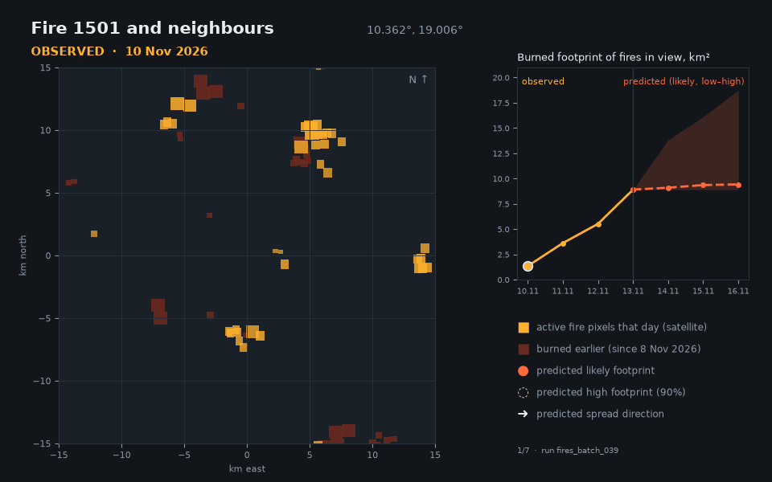
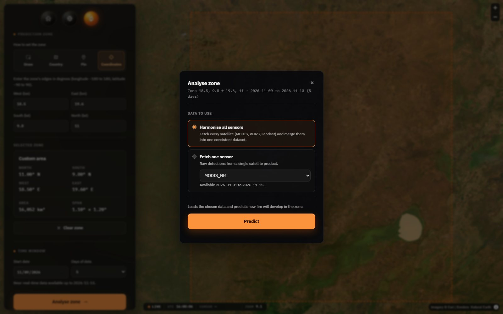

# Nasa: wildfire tracking and 3-day fire prediction

**Turns raw NASA FIRMS satellite fire detections into tracked fires, a knowledge graph and a 3-day forecast of how each fire grows, moves, burns and merges, with an interactive globe to explore it.**


```bash
python run_pipeline.py --date 2026-11-01 --days 1 --area world --no-weather
python prediction_engine.py --run data/runs/2026-11-01_1d_world --limit 200 --weather forecast.json
```

The first command downloads one day of worldwide MODIS and VIIRS detections from NASA FIRMS and runs the full tracking pipeline on it. The second predicts, for the 200 largest active fires, their footprint, chance of growing and expected growth, spread direction and rate, fire power, chance of going out or merging with a neighbour, and a 1 km burn-chance map for each of the next 3 days. Each number comes as a low / likely / high range.

## What it does

| Part | What you get |
|---|---|
| Harmonisation | MODIS, VIIRS (Suomi NPP, NOAA-20, NOAA-21) and Landsat detections made directly comparable, with the FIRMS `type` field inferred where a file lacks it |
| Tracking pipeline | Detections linked across satellites and passes, false and duplicate detections removed, then each fire's position, movement, radiative power (FRP), starting points and pass-by-pass expansion: ignitions, bursts, merges, splits, extinctions |
| Weather | Hourly weather for every fire from Open-Meteo (ERA5 observations and archived ECMWF forecasts) |
| Knowledge graph | Every result of every stage as Neo4j bulk-import CSV files |
| Prediction engine | GPU-trained models (XGBoost with a survival model and a two-part growth model, plus a sequence network) blended into a 3-day forecast per fire, plus a calibrated burn-chance map |
| Fire chains | Fires that vanish from the satellite data for up to 3 days and come back are treated as one continuing fire, so the models learn real extinctions |
| Terrain and fuel | Elevation, slope and slope direction (Copernicus DEM) and land cover (ESA WorldCover) around every fire |
| Merge dataset | Every observed merge, with the individual fires before it and the merged fire after it, their geometry and the weather |
| Frontend | A React app with a 3D globe: pick a zone, load the detections, see the forecast and fire weather |

## Screenshots

| | |
|---|---|
|  |  |
| **Frontend: the globe.** Satellite imagery from Esri, borders from Natural Earth | **Frontend: a forecast** for a zone in southern Chad: expected burning cells for days +1 to +3, chance-of-fire chart, weather layers and a timeline of observed and forecast days |
|  |  |
| **Outlook map:** the 200 largest fires on 1 Nov 2026, coloured by predicted growth. The side panel shows one fire's 3-day ranges | **Fire view:** satellite pixels and the burned scar, the predicted likely and high footprints, spread arrows and merge partners for day +2 |



*Fire 1501 in southern Chad: four observed days of satellite fire pixels (bright on the day they burned, dark afterwards), then the 3 predicted days with likely and high footprints, spread direction and the chances of merging or going out. Made with `prediction_animation.py`.*

## Contents

- [Requirements and installation](#requirements-and-installation)
- [Configuration](#configuration)
- [Usage](#usage)
- [Frontend](#frontend)
- [Pipeline](#pipeline)
- [Prediction models](#prediction-models)
- [Metrics](#metrics)
- [Data layout](#data-layout)
- [Testing](#testing)
- [Limitations](#limitations)
- [Data sources and APIs](#data-sources-and-apis)
- [Credits](#credits)

## Requirements and installation

| Need | Version used | For |
|---|---|---|
| Python | 3.14.7 | Everything in Python |
| A NASA FIRMS map key | [request one](https://firms.modaps.eosdis.nasa.gov/api/map_key/) | Downloading detections |
| [Git LFS](https://git-lfs.com/) | 3.8 | The trained models in `models/v2/` (285 MB) |
| NVIDIA GPU with CUDA | RTX 5060, CUDA 12.8 | Training only; prediction runs on the CPU too |
| Node.js and npm | – | Only to change the frontend; its built version is in the repository |

```bash
git lfs install
git clone https://github.com/Stefania1305/Nasa.git
cd Nasa
pip install pandas numpy requests scipy scikit-learn xgboost matplotlib pillow
```

Tested with pandas 3.0.6, numpy 2.5.4, xgboost 3.4.1 (CUDA build), scikit-learn 1.9.1, scipy 1.18.1, requests 2.34.2, matplotlib 3.11.2 and Pillow 12.3.0. Training the sequence network also needs PyTorch with CUDA: `pip install torch --index-url https://download.pytorch.org/whl/cu128`. Running predictions does not.

If you cloned without Git LFS, fetch the models afterwards with `git lfs pull`.

## Configuration

Settings are read from a `.env` file in the project folder. It is git-ignored; never commit it.

```ini
FIRMS_MAP_KEY=your_firms_key
```

| Variable | Required | Default | Used for |
|---|---|---|---|
| `FIRMS_MAP_KEY` | yes | none | All FIRMS downloads |
| `FIRMS_MAP_KEYS` | no | `FIRMS_MAP_KEY` | Comma-separated keys for the 10-year archive scan; when one reaches its quota (5,000 transactions per 10 minutes), the next is used |
| `PORT` | no | `8000` | Port of the local server |
| `EWDS_API_KEY`, `EWDS_API_URL` | no | none | Copernicus CEMS fire danger indices; off by default |

Open-Meteo needs no key. Its free limits are 600 calls a minute, 5,000 an hour and about 10,000 a day.

## Usage

### Run the pipeline for a date and area

```bash
python run_pipeline.py --date 2026-11-01 --days 1 --area world --no-weather
```

| Option | Default | Meaning |
|---|---|---|
| `--date` | required | First day, `YYYY-MM-DD` |
| `--days` | `1` | Number of days |
| `--area` | `world` | `world` or a box `west,south,east,north`, for example `--area=-48,-12,-42,-6` |
| `--no-weather` | off | Skip the weather join and knowledge-graph feed 2 (a world day needs about 32,000 Open-Meteo calls) |
| `--start-at` | none | Skip earlier stages and reuse their output, for example `--start-at interpreter` |

Output goes to `data/runs/<date>_<days>d_<area>/`, with stage timings in `timings.json`. On a one-day world run, the stages from the interpreter to KG feed 1 took about 7 minutes.

### Predict

```bash
python prediction_engine.py --run data/runs/fires_batch_039 --weather forecast.json
```

```python
from prediction_engine import predict
result = predict(run_dir, weather=forecast_rows)      # forecast_rows: hourly forecast, list of dicts or DataFrame
```

| Option | Default | Meaning |
|---|---|---|
| `--run` | required | A pipeline run folder |
| `--weather` | none | Hourly weather forecast for the fires' area (`.json` or `.csv`). Without it, the no-weather models are used |
| `--weather-label` | none | Where the forecast came from; shown in `summary.json` and on the map |
| `--limit` | `0` (all) | Only the N largest active fires |

The engine does not download weather: the forecast comes from the caller (the frontend), as hourly rows in the units the models were trained on.

| Field | Unit | Required |
|---|---|---|
| `latitude`, `longitude` | degrees | yes |
| `time` | UTC hour, ISO 8601, e.g. `2026-11-14T13:00` | yes |
| `temperature_2m` | °C | recommended |
| `relative_humidity_2m` | % | recommended |
| `wind_speed_10m`, `wind_gusts_10m` | km/h | recommended |
| `wind_direction_10m` | degrees the wind comes from | recommended |
| `precipitation` | mm per hour | recommended |
| `vapour_pressure_deficit` | kPa | recommended |
| `soil_moisture_0_to_7cm`, `_7_to_28cm`, `_28_to_100cm` | m³/m³ | optional |
| `elevation` | m | optional |

```json
{"hourly": [
  {"latitude": 10.25, "longitude": 19.25, "time": "2026-11-14T13:00", "temperature_2m": 33.1,
   "relative_humidity_2m": 18, "wind_speed_10m": 14.2, "wind_direction_10m": 60, "wind_gusts_10m": 27.0,
   "precipitation": 0, "vapour_pressure_deficit": 4.1}
]}
```

The forecast should cover the run's last day through 3 days ahead; a few days before that let the engine count the hours since the last rain. Each fire uses the forecast point in its 0.25° cell, or the nearest within 0.5°. Missing variables or hours are allowed.

| Output in `<run>/prediction/` | Content |
|---|---|
| `predictions.csv`, `predictions.json` | One row per fire and day ahead, with low / likely / high values |
| `spread.csv` | Burn chance per 1 km cell around each fire and day ahead (cells of at least 2%) |
| `predictions.csv` columns `p_grow`, `growth_expected` | Chance the fire grows by at least 0.1 km² that day, and the expected (average) growth |
| `merge_outlook.csv` | Each fire's nearest neighbour, the gap between their predicted footprints and the merge chance |
| `summary.json` | Run, weather used and its coverage, models, timing |

### Build the 10-year archive and train the models

```bash
python archive_scan.py --start 2016-11-14 --end 2026-11-13
python fire_runs.py --major 1000 --medium 1000
python weather_fires.py
python prediction_data.py --chains --out fire_days_v3.csv.gz
python static_features.py terrain
python static_features.py landcover
python forecast_errors.py
python prediction_v3.py --table fire_days_v4.csv.gz --full --variant weather --out models_v4_full
python prediction_v3.py --table fire_days_v4.csv.gz --full --variant no_weather --out models_v4_full
python prediction_seq.py --table fire_days_v4.csv.gz --bins out,merge,grow --full --epochs 16 --out models_seq_v4_full
python prediction_spread.py fit
```

| Step | What it does |
|---|---|
| `archive_scan.py` | Downloads 10 years of MODIS and VIIRS worldwide, builds a fire frequency map and ranks the biggest fires |
| `fire_runs.py` | Picks 1,000 major and 1,000 medium fires across regions and runs the full pipeline on them in 40 batches |
| `weather_fires.py` | Adds weather to every batch and feeds it into the knowledge graph, within the Open-Meteo quota |
| `prediction_data.py --chains` | Builds the training table: one row per fire per day, 333,452 fire-days from 188,559 fires linked into 144,229 chains, with targets for days +1 to +3 along each chain (`prediction_labels.py`) |
| `forecast_errors.py` | Measures how wrong real weather forecasts were at about 200 cells: a pool of 4,590 error vectors used in training |
| `static_features.py terrain` / `landcover` | Reads elevation, slope and slope direction (Copernicus DEM, at its 180 m overview) and land-cover shares within 1 and 5 km (ESA WorldCover, at its 40 m and 320 m overviews) for all 283,905 fire locations, over HTTP from AWS open data (about 18 minutes). The v4 table (`fire_days_v4.csv.gz`) is the v3 table plus these columns (`prediction_data.add_static`) |
| `prediction_v3.py` | Trains the v3 tree models for one variant: survival model for extinction, two-part growth, fire power, movement and merging (25 models, about 28 minutes on the GPU with both variants in parallel). Without `--full` it trains on 2016–2023 for testing |
| `prediction_seq.py` | Trains the sequence network (about 1 minute on the GPU) and saves it for numpy too; `--bins out,merge,grow` adds the chance-it-grows output |
| `prediction_spread.py fit` | Calibrates the burn-chance map on 2024 and checks it on 2025–2026 |

### Animation and merge datasets

```bash
python prediction_animation.py --run data/runs/fires_batch_039 --fire 1501
python merges_dataset.py
```

`prediction_animation.py` writes `<run>/prediction/spread_<fire>.gif`. `merges_dataset.py` writes `data/prediction/merges.csv.gz` (one row per merge: 166,044 merges, 51,051 of them lasting merges of separate fires) and `merge_members.csv.gz` (one row per fire involved: 405,039 individual fires before a merge and 275,049 merged fires after it, sharing an `event_id`).

## Frontend

**Fire Pattern Predictor** is a React app by Diaco12, on the [`frontend`](https://github.com/Stefania1305/Nasa/tree/frontend) branch. It is not yet connected to the prediction models described below: its forecast uses a separate grid model ([see below](#frontend-grid-model)).

| Feature | Description |
|---|---|
| Opening screen | Live status of each satellite's latest data (MODIS, VIIRS on Suomi NPP, NOAA-20 and NOAA-21, Landsat OLI) and a spinning globe |
| 3D globe | MapLibre GL globe with Esri satellite imagery, Natural Earth borders, zoom and a live UTC clock |
| Zones | Draw a box, click a country (or one of its territories), drop a pin with an area, or type coordinates |
| Analyse zone | Load either all sensors harmonised into one dataset, or one sensor's raw detections, for a chosen date range |
| Forecast | Expected burning cells for days +1 to +3, cells by chance of fire, spread direction, trend, most likely new fires, and a timeline of observed and forecast days |
| Fire weather | Temperature, humidity and wind layers over the zone from Open-Meteo |



| Part | Technology |
|---|---|
| UI | [React](https://react.dev/) 18, TypeScript, [Vite](https://vite.dev/) 6 |
| Map | [MapLibre GL](https://maplibre.org/) 5.6 (globe projection) |
| State | [Zustand](https://github.com/pmndrs/zustand) 5 |
| Fonts | IBM Plex Sans and IBM Plex Mono |
| Backend | `server.py` serves the built app at `http://localhost:8000/app` |

```bash
git switch frontend
python server.py          # then open http://localhost:8000/app

cd frontend               # only to change the app
npm install
npm run dev               # http://localhost:5173/app/, API calls go to the backend on :8000
npm run build
```

| Endpoint (`frontend` branch) | Returns |
|---|---|
| `/api/sensors` | Available FIRMS sensors and their date ranges |
| `/api/harmonise` | All sensors harmonised for a date range and area |
| `/api/fires` | One sensor's detections |
| `/api/compare` | MODIS and VIIRS made comparable |
| `/api/predict` | The grid forecast for a zone (`date`, `days`, `area`, optional `country`) |
| `/api/weather` | Fire weather for a zone from Open-Meteo |

## Pipeline

```
FIRMS download
  -> correlation          link detections across satellites and passes
  -> interpreter          clean and plan the work
  -> localisation  ┐      position and movement per pass
  -> fire power    ┘      radiative power per pass (both run at the same time)
  -> epicenter            where each fire started
  -> fire expansion       clusters followed pass by pass
  -> KG feed 1 (fire)     kg_builder.py
  -> weather join         weather_worker.py
  -> KG feed 2 (weather)  kg_weather_feed.py
```

Each stage reads the previous stage's files in the run folder. The knowledge graph (`<run>/kg/`) holds every worker's results as `nodes_*.csv.gz` and `rels_*.csv.gz` in [Neo4j bulk-import format](https://neo4j.com/docs/operations-manual/current/import/). Node types include `Fire`, `SourceFire`, `Detection`, `Cluster`, `FireState`, `Epicenter`, `ExpansionEvent`, `Pass`, `Satellite`, `WeatherCell` and `WeatherHour`.

## Prediction models

### Fire chains: why v3 exists

Satellites only see a fire when they pass over and the sky is clear. A fire can disappear for a day or two (clouds, smoke, a missed pass, too small for one pass) and then come back, and the tracking then starts a "new" fire. In the 2025–2026 test years, **43% of the fire-days labelled "extinguished" were followed by a fire within 5 km in the next 3 days** (49% for fires under 1 km²). Trained on those labels, the earlier models predicted that most small fires go out, while in reality many kept burning or grew.

v3 links such fires into chains (`prediction_labels.py`): fire B continues fire A when B is first seen 1–3 days after A's last sighting, within 5 km plus A's radius. Footprint, history and every target follow the chain, and a fire counts as out only when nothing continued it within 3 days. On the training table this turned 188,559 fires into 144,229 chains; "out by the next day" fell from 56% to 43% of fire-days and "grew at least 0.1 km²" rose from about 27% to 34%.

### Models

| Model | What it is | Where | Status |
|---|---|---|---|
| **v4 blend** | v4 XGBoost and the v4 sequence network averaged for growth, chance it grows, fire power, movement and merging; extinction from the survival model | `prediction_engine.py` | **In production** |
| v4 XGBoost | Survival model for extinction (`survival:aft`, censored when the data ends, calibrated per day ahead), two-part growth (chance it grows ≥ 0.1 km² + how much if it does), quantile models for fire power and movement, merge classifier. Trained on fire chains with forecast-like weather, plus terrain and land cover (149 features with weather, 86 without) | `models/v4/weather`, `models/v4/no_weather` | In production |
| v4 sequence network | A GRU over the chain's previous 4 fire-days plus dense layers, all outputs and days at once (including the chance it grows), trained with weather dropout and forecast noise. Trained with [PyTorch](https://pytorch.org/), run with numpy | `models/v4/seq` | In production |
| Spread map | Logistic model turning distance and position around today's moved and spread-out pixels into a burn chance per 1 km cell | `models/v4/spread.json` | In production |
| v3 blend | The same models without terrain and land cover | git history (`models/v3`) | Superseded |
| v2 blend | XGBoost (118 features) and sequence network trained on the uncorrected labels | git history (`models/v2`) | Superseded |
| Fast model | The first XGBoost models (87 features) | `data/prediction/models_split` | Superseded |
| Frontend grid model | Ridge-regularised logistic regression on 5.6 km grid cells, refitted on each zone's loaded days | `prediction.py` on the `frontend` branch | In the app today |

For every fire seen on the run's last day, the engine predicts days +1, +2 and +3:

| Output | Unit | Form |
|---|---|---|
| New burned area and total footprint | km² | low / likely / high (10th / 50th / 90th percentile) |
| **Chance the fire grows** by at least 0.1 km² | 0 to 1 | probability (`p_grow`) |
| **Expected growth** | km² | average, calibrated on unseen data (`growth_expected`) |
| Movement of the fire centre, spread direction and rate | km, degrees, km/day | low / likely / high |
| Mean and peak fire power of a VIIRS pass | MW | low / likely / high |
| Chance the fire is out | 0 to 1 | probability from the survival model |
| Chance it merges with a separate neighbouring fire | 0 to 1 | probability |
| Burn chance of each 1 km cell around the fire | 0 to 1 | spread map |

The "likely" growth is the median, so for a small fire that grows on fewer than half of the days it is close to 0 even when growth is quite possible; `p_grow` and `growth_expected` show that possibility directly.

| Feature group | Features (149 with weather) |
|---|---|
| Fire now | Size, footprint, growth, fire power, pixels, passes, clusters, front distance, age, merges so far (along the chain) |
| History | The previous 4 fire-days of the chain: growth, power, separate parts, days back; 3-day trends |
| Separate parts | How many not-yet-joined fires the fire consists of that day, and the gap between them |
| Neighbours | Distance and gap to the nearest other fire, its size, growth and power, fires within 10 and 25 km |
| Place | Latitude, region, season, elevation, local 10-year fire frequency |
| Terrain | Mean elevation and its spread (ruggedness), mean and 90th-percentile slope, downslope direction, within about 3 km (Copernicus DEM), and the wind component blowing uphill on days +1 to +3 |
| Fuel | Share of tree, shrub, grass, crop, built-up, bare, snow, water, wetland, mangrove and moss within about 1 km and 5 km (ESA WorldCover) |
| Weather, days d to d+3 | Temperature, humidity, vapour pressure deficit, wind, gusts and direction, rain, hours since rain, soil moisture at 3 depths, wind towards the nearest fire |

### Terrain and fuel (v4)

v4 adds what burns and the shape of the ground: land-cover shares from ESA WorldCover and elevation, slope and slope direction from the Copernicus DEM, read for all 283,905 fire locations (`static_features.py`). The tree models use them in physically sensible ways; share of each model's total gain (with weather):

| Model | Terrain % | Land cover % | Most used |
|---|---|---|---|
| survival | 3.8 | 4.0 | elev_mean, lc5_tree, slope_mean |
| grow_1 | 4.2 | 4.1 | elev_mean, lc1_grass, lc1_tree |
| amount_1 | 1.6 | 1.5 | downslope_n, w3_wind_upslope, lc5_grass |
| frp_1 | 2.6 | 3.1 | lc1_grass, elev_mean, lc5_crop |
| dx_1 | 4.9 | 5.4 | lc5_grass, downslope_n, elev_mean |
| dy_1 | 5.4 | 5.5 | downslope_e, lc5_grass, downslope_n |
| merge_1 | 3.1 | 2.9 | downslope_e, downslope_n, elev_mean |
| grow_3 | 4.6 | 4.4 | w3_wind_upslope, elev_mean, lc5_grass |
| frp_3 | 3.0 | 3.6 | lc5_crop, elev_mean, lc1_grass |
| dx_3 | 5.4 | 6.2 | lc5_grass, downslope_n, downslope_e |

With weather, v4 scores the same as v3 (within ±0.2 points overall): the place's character is largely carried by the weather already. Without a forecast, v4 is 0.7–1.0 points better than v3, recovering part of the gap to the with-weather models. The sequence network did not gain from these features. Copernicus CEMS fire danger indices (FWI) were not added: Copernicus processes one request at a time, which would take many hours, and deep soil moisture already covers most of their long-term dryness signal.

All models train on **forecast-like weather**: each training row's weather for days +1 to +3 gets a real forecast error added (same day ahead and region), so they trust a forecast only as much as forecasts deserve.

## Metrics

All models below were trained on 2016–2023 (2024 used only to stop training, pick thresholds and calibrate) and tested on **2025–2026, which none of them saw: 49,378 fire-days from 28,657 fires**, scored against the **corrected (fire-chain) labels**. Each cell shows **day +1 / +2 / +3**, with weather unless stated. Persistence: "the fire keeps doing what it did today". The production models are the same setups trained on all years. Produced by `prediction_metrics.py`, `test_prediction_accuracy.py` and `test_small_fires.py`; full results in `data/prediction/accuracy/`.

> Earlier versions of this README reported about 65% overall for v2. That was measured against the uncorrected labels, which rewarded predicting the false extinctions. On the corrected labels the same v2 models score 61.6 / 60.3 / 59.3%, and their chances of extinction were off by 13.6 / 9.5 / 6.2 percentage points.

### Headline accuracy

Mean of five accuracies: growth class (none / small / large), fire power within a factor of 2, direction within 45°, extinction, and merge balanced accuracy (merge threshold chosen for the best balanced accuracy on 2024).

| Model | Overall accuracy %, with weather | Overall accuracy %, no weather |
|---|---|---|
| v2 blend | 61.6 / 60.3 / 59.3 | 60.3 / 58.7 / 58.3 |
| v3 blend | 62.2 / 61.1 / 60.8 | 61.0 / 59.4 / 59.3 |
| v4 XGBoost | 62.1 / 60.8 / 60.6 | 61.8 / 60.5 / 60.1 |
| v4 sequence network | 61.7 / 60.4 / 60.3 | 60.3 / 58.9 / 58.7 |
| **v4 blend (production)** | **62.4 / 61.0 / 60.9** | **61.7 / 60.4 / 60.0** |

In the detailed tables the merge threshold is chosen for the best F1 instead, which raises merge precision and lowers merge balanced accuracy.

### What happens to fires by size

The check that found the problem: what really happened against what v2 and v3 predicted.

| Day | Fire size | Fire-days | Really out % | v2 says out % | v4 says out % | Really grew % | v2 likely grew % | v4 chance it grows % | Real mean growth km² | v4 expected growth km² |
|---|---|---|---|---|---|---|---|---|---|---|
| +1 | under 1 km² | 25,054 | 51.8 | 81.3 | **57.8** | 23.6 | 1.7 | **20.6** | 0.25 | 0.12 |
| +1 | 1-10 km² | 17,981 | 41.4 | 48.3 | **41.3** | 36.4 | 22.5 | **33.9** | 0.83 | 0.5 |
| +1 | 10-100 km² | 4,711 | 20.7 | 13.7 | **17.6** | 68.6 | 80.6 | **69.0** | 7.33 | 5.58 |
| +1 | over 100 km² | 1,632 | 12.9 | 10.2 | **13.7** | 84.3 | 91.5 | **85.1** | 62.78 | 49.37 |
| +3 | under 1 km² | 25,054 | 73.6 | 92.2 | **85.4** | 40.1 | 3.5 | **36.2** | 0.69 | 0.3 |
| +3 | 1-10 km² | 17,981 | 65.3 | 71.6 | **65.8** | 50.1 | 24.6 | **48.4** | 2.63 | 1.41 |
| +3 | 10-100 km² | 4,711 | 48.2 | 39.7 | **34.4** | 74.0 | 68.6 | **75.8** | 20.5 | 16.07 |
| +3 | over 100 km² | 1,632 | 36.8 | 34.0 | **26.8** | 85.2 | 76.8 | **86.2** | 158.34 | 137.24 |

### Extinction (is the fire out by that day?)

Threshold 0.5. Calibration error: mean gap between the predicted chance and how often fires were really out, over 10 bins. v2 is scored here on the corrected labels; its calibration was off by 13.6 / 9.5 / 6.2 points, v4's by 1.9 / 0.9 / 1.2.

| Model | Accuracy % | Precision % | Recall % | F1 % | ROC AUC | PR AUC | Brier | Calibration error, pts |
|---|---|---|---|---|---|---|---|---|
| v2 blend | 71.9 / 75.9 / 79.0 | 62.9 / 73.6 / 79.6 | 87.0 / 90.5 / 92.4 | 73.0 / 81.1 / 85.5 | 0.819 / 0.845 / 0.857 | 0.749 / 0.869 / 0.918 | 0.1978 / 0.1694 / 0.1455 | 13.54 / 9.54 / 6.27 |
| v4 XGBoost (survival + two-part growth, terrain, land cover) | 74.4 / 77.3 / 79.3 | 69.5 / 78.7 / 82.4 | 73.9 / 83.0 / 88.0 | 71.7 / 80.8 / 85.1 | 0.832 / 0.855 / 0.858 | 0.793 / 0.883 / 0.919 | 0.1657 / 0.1531 / 0.1408 | 1.92 / 0.92 / 1.26 |
| v4 sequence network | 74.0 / 76.4 / 79.1 | 69.7 / 76.9 / 80.9 | 72.0 / 84.2 / 90.1 | 70.8 / 80.4 / 85.3 | 0.829 / 0.852 / 0.861 | 0.790 / 0.884 / 0.925 | 0.1672 / 0.1543 / 0.1387 | 2.31 / 1.23 / 1.05 |
| **v4 blend (production)** | 74.4 / 77.3 / 79.3 | 69.5 / 78.7 / 82.4 | 73.9 / 83.0 / 88.0 | 71.7 / 80.8 / 85.1 | 0.832 / 0.855 / 0.858 | 0.793 / 0.883 / 0.919 | 0.1657 / 0.1531 / 0.1408 | 1.92 / 0.92 / 1.26 |
| Persistence baseline | 56.3 / 42.6 / 33.0 | 0.0 / 0.0 / 0.0 | 0.0 / 0.0 / 0.0 | 0.0 / 0.0 / 0.0 | – / – / – | – / – / – | – / – / – | – / – / – |

### Chance it grows (by at least 0.1 km²)

| Model | Accuracy % | Precision % | Recall % | F1 % | ROC AUC | PR AUC | Calibration error, pts |
|---|---|---|---|---|---|---|---|
| v4 XGBoost (survival + two-part growth, terrain, land cover) | 76.8 / 72.3 / 72.0 | 78.2 / 76.5 / 76.3 | 45.6 / 52.4 / 61.4 | 57.6 / 62.2 / 68.0 | 0.796 / 0.800 / 0.809 | 0.731 / 0.780 / 0.812 | 2.60 / 2.83 / 2.74 |
| v4 sequence network | 76.7 / 72.2 / 71.7 | 78.6 / 76.7 / 76.0 | 44.9 / 51.7 / 60.9 | 57.2 / 61.8 / 67.6 | 0.796 / 0.796 / 0.804 | 0.730 / 0.777 / 0.809 | 2.23 / 2.60 / 2.55 |
| **v4 blend (production)** | 76.9 / 72.6 / 72.3 | 79.2 / 77.4 / 76.9 | 45.1 / 52.0 / 61.2 | 57.5 / 62.2 / 68.2 | 0.801 / 0.803 / 0.811 | 0.736 / 0.783 / 0.815 | 2.38 / 2.50 / 2.47 |

### Merging with a separate fire

Threshold chosen for the best F1 on 2024. Merges are rare (4–8% of fire-days), so plain accuracy is not shown.

| Model | Balanced acc. % | Precision % | Recall % | F1 % | ROC AUC | PR AUC | Brier |
|---|---|---|---|---|---|---|---|
| v2 blend | 71.1 / 78.6 / 77.4 | 53.1 / 50.2 / 58.8 | 43.9 / 61.2 / 58.4 | 48.1 / 55.2 / 58.6 | 0.947 / 0.938 / 0.931 | 0.518 / 0.599 / 0.645 | 0.0265 / 0.0377 / 0.0444 |
| v4 XGBoost (survival + two-part growth, terrain, land cover) | 71.1 / 75.3 / 79.4 | 51.6 / 54.7 / 52.8 | 43.9 / 53.6 / 63.8 | 47.5 / 54.2 / 57.8 | 0.945 / 0.937 / 0.931 | 0.506 / 0.588 / 0.637 | 0.0270 / 0.0385 / 0.0452 |
| v4 sequence network | 72.3 / 75.5 / 76.7 | 49.0 / 56.1 / 58.9 | 46.6 / 53.8 / 56.9 | 47.8 / 54.9 / 57.9 | 0.942 / 0.934 / 0.929 | 0.507 / 0.586 / 0.634 | 0.0268 / 0.0383 / 0.0450 |
| **v4 blend (production)** | 69.2 / 73.7 / 77.8 | 56.8 / 59.5 / 58.1 | 39.6 / 49.7 / 59.3 | 46.7 / 54.2 / 58.7 | 0.946 / 0.938 / 0.933 | 0.517 / 0.597 / 0.644 | 0.0266 / 0.0379 / 0.0445 |
| Persistence baseline | 50.0 / 50.0 / 50.0 | 0.0 / 0.0 / 0.0 | 0.0 / 0.0 / 0.0 | 0.0 / 0.0 / 0.0 | – / – / – | – / – / – | – / – / – |

### Growth of the burned area

Class: none (< 0.1 km²), small (0.1–2 km²) or large (≥ 2 km²). Coverage: share of real values inside the low–high range (aim about 80%).

| Model | MAE km² | Class accuracy % | Class macro F1 % | Low–high coverage % | Pinball loss (log) |
|---|---|---|---|---|---|
| v2 blend | 1.95 / 3.58 / 5.10 | 72.4 / 64.6 / 60.1 | 60.1 / 55.0 / 51.1 | 80.8 / 75.5 / 70.7 | 0.0747 / 0.1010 / 0.1262 |
| v4 XGBoost (survival + two-part growth, terrain, land cover) | 1.96 / 3.59 / 5.05 | 72.9 / 66.9 / 65.3 | 60.8 / 60.9 / 62.8 | 87.9 / 87.6 / 87.5 | 0.0729 / 0.0924 / 0.1033 |
| v4 sequence network | 2.01 / 3.64 / 5.16 | 72.5 / 66.4 / 64.1 | 60.8 / 59.9 / 60.7 | 84.9 / 82.6 / 81.2 | 0.0730 / 0.0920 / 0.1033 |
| **v4 blend (production)** | 1.94 / 3.53 / 4.98 | 72.9 / 66.8 / 65.4 | 61.5 / 61.2 / 63.4 | 85.5 / 83.4 / 82.1 | 0.0717 / 0.0906 / 0.1013 |
| Persistence baseline | 2.85 / 5.87 / 9.07 | 32.5 / 35.9 / 36.4 | 37.8 / 37.3 / 35.8 | – / – / – | – / – / – |

### Fire power (FRP)

| Model | MAE MW | Within ×2 % | Low–high coverage % | Peak FRP MAE MW |
|---|---|---|---|---|
| v2 blend | 295 / 370 / 420 | 39.9 / 37.2 / 36.2 | 76.6 / 77.1 / 75.5 | 537 / 687 / 789 |
| v4 XGBoost (survival + two-part growth, terrain, land cover) | 299 / 375 / 424 | 39.8 / 37.1 / 37.3 | 73.5 / 73.1 / 71.8 | 543 / 701 / 799 |
| v4 sequence network | 306 / 375 / 420 | 39.9 / 37.7 / 37.9 | 78.3 / 77.9 / 76.6 | 559 / 696 / 793 |
| **v4 blend (production)** | 298 / 370 / 416 | 40.2 / 37.9 / 38.0 | 76.6 / 76.3 / 74.7 | 543 / 687 / 783 |
| Persistence baseline | 420 / 579 / 645 | 33.2 / 30.1 / 30.0 | – / – / – | 766 / 1077 / 1232 |

### Spread direction and centre movement

Fires that moved at least 1 km.

| Model | Within 45° % | Within 90° % | Median angle error ° | Median centre error km |
|---|---|---|---|---|
| v2 blend | 35.4 / 36.3 / 34.7 | 59.5 / 59.4 / 59.3 | 70.7 / 70.6 / 71.7 | 2.97 / 3.37 / 3.71 |
| v4 XGBoost (survival + two-part growth, terrain, land cover) | 35.8 / 35.8 / 34.9 | 59.5 / 60.5 / 59.2 | 70.0 / 69.6 / 71.7 | 2.95 / 3.36 / 3.72 |
| v4 sequence network | 35.1 / 35.0 / 34.7 | 59.8 / 59.6 / 59.7 | 71.1 / 71.5 / 71.5 | 2.97 / 3.38 / 3.73 |
| **v4 blend (production)** | 36.5 / 35.8 / 35.2 | 60.1 / 59.9 / 59.9 | 69.5 / 70.4 / 71.0 | 2.94 / 3.36 / 3.71 |
| Persistence baseline | 21.1 / 19.8 / 20.5 | 38.7 / 37.8 / 38.8 | 115.6 / 116.4 / 114.2 | 5.48 / 9.13 / 12.76 |

### Without weather

| Model | Extinction ROC AUC | Extinction calibration, pts | Merge ROC AUC | Growth MAE km² | FRP within ×2 % |
|---|---|---|---|---|---|
| v2 blend | 0.773 / 0.779 / 0.787 | 14.17 / 10.15 / 7.15 | 0.944 / 0.933 / 0.924 | 2.09 / 3.98 / 5.78 | 39.1 / 36.0 / 36.1 |
| v4 XGBoost (survival + two-part growth, terrain, land cover) | 0.820 / 0.845 / 0.848 | 1.99 / 1.01 / 1.21 | 0.943 / 0.936 / 0.930 | 1.99 / 3.70 / 5.17 | 39.7 / 37.1 / 36.9 |
| v4 sequence network | 0.773 / 0.781 / 0.780 | 1.61 / 1.13 / 1.59 | 0.940 / 0.930 / 0.922 | 2.15 / 4.04 / 5.76 | 39.4 / 37.3 / 37.5 |
| **v4 blend (production)** | 0.820 / 0.845 / 0.848 | 1.99 / 1.01 / 1.21 | 0.944 / 0.936 / 0.929 | 2.01 / 3.74 / 5.29 | 40.2 / 37.6 / 37.3 |

### Robustness (v4)

Retrained without one year or one world region and tested on what was left out (quicker check models: learning rate 0.1, days +1 and +3).

| Left out of training | Overall accuracy %, day +1 / +3 |
|---|---|
| Year 2024 | 62.2 / 59.8 |
| Americas | 61.6 / 59.4 |
| Africa | 60.9 / 58.2 |

### With real weather forecasts

Measured for the earlier models (on the old labels) with the forecasts that were issued at the time. v3 and v4 have not been tested this way yet.

| Overall accuracy %, day +1 / +2 / +3 | Fast model | v2 XGBoost |
|---|---|---|
| Observed weather | 66.1 / 65.3 / 65.9 | 67.0 / 65.7 / 66.4 |
| Issued forecasts (real use) | 64.1 / 62.1 / 64.5 | 65.0 / 63.8 / 64.8 |
| No-weather models | 64.9 / 62.8 / 64.7 | 65.2 / 63.1 / 64.4 |

### Spread map (burn chance per 1 km cell)

Calibrated on 2024, checked on 2025–2026. A cell counts as burned if any satellite detected fire in it that day.

| Day | ROC AUC | Brier | Brier of the base rate | Cells that burned % | Cells checked |
|---|---|---|---|---|---|
| Day +1 | 0.728 | 0.0477 | 0.0502 | 5.3 | 451,051 |
| Day +2 | 0.732 | 0.0338 | 0.0348 | 3.61 | 473,015 |
| Day +3 | 0.753 | 0.0250 | 0.0257 | 2.64 | 491,278 |

### Behaviour checks

The v4 blend passes all 11: more wind or drier air gives more growth, drier air more fire power, rain raises the chance of extinction and cuts growth, turning the wind turns the predicted spread, raw growth is never negative, ranges are ordered, chances stay in 0..1, results are deterministic and it works without weather.

### Frontend grid model

The app's grid model scores itself on each request: refitted without the last loaded day, then asked to predict it. For the southern Chad zone in the screenshots (18.5–19.6° E, 9.8–11.0° N, 9–13 Nov 2026, 5.6 km cells, top 123 cells):

| | AUC | Precision % | Recall % | F1 % |
|---|---|---|---|---|
| Frontend grid model | 0.739 | 28.5 | 33.0 | 30.6 |
| Persistence (cells burning yesterday) | – | 37.6 | 44.3 | 40.7 |

That is one zone and one day, so it says little in general, but here persistence did better than the grid model.

## Data layout

```
models/v4/                   production models shipped with the repository (Git LFS, 339 MB)
  weather/ no_weather/       25 compressed XGBoost models each (survival, two-part growth, fire power, movement, merging)
  seq/                       sequence network as numpy arrays
  spread.json                (models/v2 and models/v3 are in git history)
docs/images/                 README images
data/                        git-ignored: rebuild with the commands in Usage
  archive/                   10-year scan: raw FIRMS files, frequency map, selected fires
  runs/<run>/                one folder per pipeline run: stage outputs, kg/, prediction/, timings.json
  prediction/                training table, models, forecast errors, merge datasets, accuracy results
  weather_cache/             cached Open-Meteo responses
```

## Testing

```bash
python test_correlation.py
python test_interpreter.py
python test_localisation.py
python test_fire_power.py
python test_epicenter.py
python test_expansion.py
python test_weather.py
python test_prediction.py
```

These run offline, with no key. The accuracy tests need the training table and models:

| Command | Checks |
|---|---|
| `python prediction_metrics.py` | Every metric above for every model |
| `python test_small_fires.py` | What happens to fires by size against what v2 and v3 predict |
| `python test_prediction_accuracy.py heldout` | Accuracy on 2025–2026, by region, fire size, season and weather coverage, plus calibration |
| `python test_prediction_accuracy.py behaviour` | Response to wind, humidity and rain, plus output rules |
| `python test_prediction_accuracy.py cv` | Retrains without one year or region (GPU) |
| `python test_prediction_accuracy.py forecast` | Accuracy with archived real forecasts (uses Open-Meteo) |

`PRED_TABLE=fire_days_v4.csv.gz` (or `_v3`) scores against the corrected labels, `PRED_MODELS=<folder>` tests another model folder, `PRED_BLEND=models_v4,models_seq_v4` a blend, and `PRED_SOIL_FROM_D=1` gives days +1 to +3 day d's soil moisture, as the models expect.

## Limitations

- **Shape:** the engine predicts each fire's area, centre shift, direction and power, not its outline.
- **Direction and fire power** are the weakest outputs (about 39% within 45° and 35–39% within ×2), though about twice as good as persistence.
- **Merge alarms:** about half of them are right at the F1 threshold, fewer at the balanced threshold.
- **Fire chains:** linking uses distance and timing only; two different fires that start close together a few days apart can be joined, and a fire that vanishes for more than 3 days is still split.
- **Expected growth** is calibrated to be right on average; for fires under 1 km² it is still about a third too low.
- **Weather coverage:** only about half of the training rows have weather; small fires outside the fetched cells have none.
- **Not yet tested with real forecasts:** the v4 real-forecast check is still to run (it needs the Open-Meteo archive).
- **Terrain and fuel for new places:** the engine reads them from the cloud the first time a place is seen (cached afterwards), so a new area needs internet access; terrain is read at 180 m and land cover at 40 m resolution, and land cover is the 2021 map.
- **Simulated forecast errors:** drawn from real errors at about 200 cells, which approximates training on archived forecasts.
- **Soil moisture:** days +1 to +3 use day d's value, because the forecast archive has none.
- **First day:** a fire seen for the first time has no history, so its predictions are less reliable.
- **Spread map:** satellites see only actively burning pixels at overpass time, so 3–5% of nearby cells register as burning on a day, which limits how sharp the map can be.
- **Frontend:** not yet connected to the production models.

## Data sources and APIs

| Source | Used for | Links |
|---|---|---|
| **NASA FIRMS** (Fire Information for Resource Management System) | All fire detections: MODIS, VIIRS and Landsat, near-real-time and standard products | [FIRMS](https://firms.modaps.eosdis.nasa.gov/) · [API](https://firms.modaps.eosdis.nasa.gov/api/) · [Area API](https://firms.modaps.eosdis.nasa.gov/api/area/) · [Data availability](https://firms.modaps.eosdis.nasa.gov/api/data_availability/) · [Map key](https://firms.modaps.eosdis.nasa.gov/api/map_key/) · [About FIRMS](https://www.earthdata.nasa.gov/data/tools/firms) · [FAQ](https://www.earthdata.nasa.gov/data/tools/firms/faq) |
| **MODIS** on NASA's Terra and Aqua | 1 km active fire detections | [NASA Earthdata: MODIS](https://www.earthdata.nasa.gov/data/instruments/modis) |
| **VIIRS** on Suomi NPP, NOAA-20 and NOAA-21 | 375 m active fire detections | [NASA Earthdata: VIIRS](https://www.earthdata.nasa.gov/data/instruments/viirs) · [NOAA JPSS](https://www.nesdis.noaa.gov/our-satellites/currently-flying/joint-polar-satellite-system) |
| **Landsat** 8 and 9 (OLI) | 30 m active fire detections (frontend) | [NASA Landsat](https://landsat.gsfc.nasa.gov/) |
| **Open-Meteo** | Observed hourly weather (ERA5), archived forecasts for training and testing, frontend fire weather | [Open-Meteo](https://open-meteo.com/) · [Forecast API](https://open-meteo.com/en/docs) · [Historical weather API (ERA5)](https://open-meteo.com/en/docs/historical-weather-api) · [Previous runs API](https://open-meteo.com/en/docs/previous-runs-api) |
| **ECMWF IFS** | The forecast model behind the archived forecasts (0.25°) | [ECMWF forecasts](https://www.ecmwf.int/en/forecasts/datasets/set-i) |
| **ERA5** (Copernicus Climate Change Service) | The reanalysis behind the observed weather | [ERA5 single levels](https://cds.climate.copernicus.eu/datasets/reanalysis-era5-single-levels) |
| **Copernicus DEM GLO-90** | Elevation, slope and slope direction around each fire | [Copernicus DEM on AWS](https://registry.opendata.aws/copernicus-dem/) |
| **ESA WorldCover 2021** (10 m) | Land cover (fuel) around each fire | [ESA WorldCover on AWS](https://registry.opendata.aws/esa-worldcover-vito/) · [ESA WorldCover](https://esa-worldcover.org/) |
| **Copernicus CEMS** fire danger indices | Optional, off by default | [CEMS fire historical](https://ewds.climate.copernicus.eu/datasets/cems-fire-historical-v1) |
| **Esri World Imagery** | Frontend globe imagery | [World Imagery service](https://server.arcgisonline.com/ArcGIS/rest/services/World_Imagery/MapServer) |
| **Natural Earth** | Country borders (frontend) | [Natural Earth](https://www.naturalearthdata.com/) |
| **world-atlas** | Basemap of the outlook map | [topojson/world-atlas](https://github.com/topojson/world-atlas) |

Libraries: [XGBoost](https://xgboost.readthedocs.io/), [PyTorch](https://pytorch.org/), [scikit-learn](https://scikit-learn.org/), [pandas](https://pandas.pydata.org/), [d3](https://d3js.org/), [React](https://react.dev/), [MapLibre GL](https://maplibre.org/), [Vite](https://vite.dev/), [Zustand](https://github.com/pmndrs/zustand).

## Credits

We acknowledge the use of data from NASA's Fire Information for Resource Management System ([FIRMS](https://www.earthdata.nasa.gov/data/tools/firms)), part of NASA's Earth Science Data and Information System. Weather data by [Open-Meteo](https://open-meteo.com/) (CC BY 4.0), based on ECMWF IFS forecasts and Copernicus ERA5. Imagery © Esri; borders from Natural Earth. Terrain: Copernicus DEM, © DLR e.V. 2010-2014 and © Airbus Defence and Space GmbH 2014-2018, provided under COPERNICUS by the European Union and ESA. Land cover: © ESA WorldCover project 2021, contains modified Copernicus Sentinel data (2021) processed by the ESA WorldCover consortium.

| Contributor | Area |
|---|---|
| [Diaco12](https://github.com/Diaco12) | Frontend (React app) |
| [Adelin12378](https://github.com/Adelin12378) | Pipeline, knowledge graph and prediction models |

## License

No license file yet. Until one is added, all rights are reserved by the authors.
